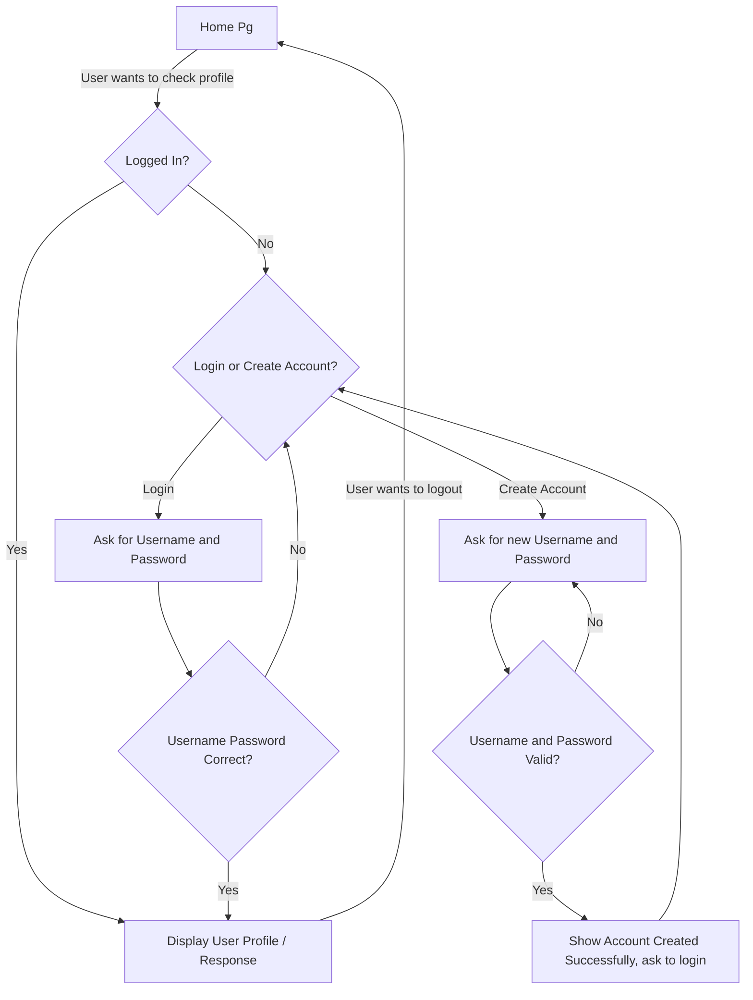

**Name:** Lucas Ou

**Team:** GOD BLESS AMERICA

**Roster:** Lucas Ou (me), Leon Wong

**PLAN**
* Map out Flowchart (as shown below)
* Create HTML for each page
* Write a Python function for each page
* Going down the flow chart, connect each page together editing the HTML and Python
* Add the cookies check in the beginning

**LOGIN FLOWCHART**


**DISCO:**
* **Notes In Class:** 
    ```
    session[KEY] = value
    session.pop(key)
    ```
* **Something** 
    text
-----------------------------------------------------------------------


**Q/C/C:**
* None for now
-----------------------------------------------------------------------


**OTHER?**
* []()
*
-----------------------------------------------------------------------