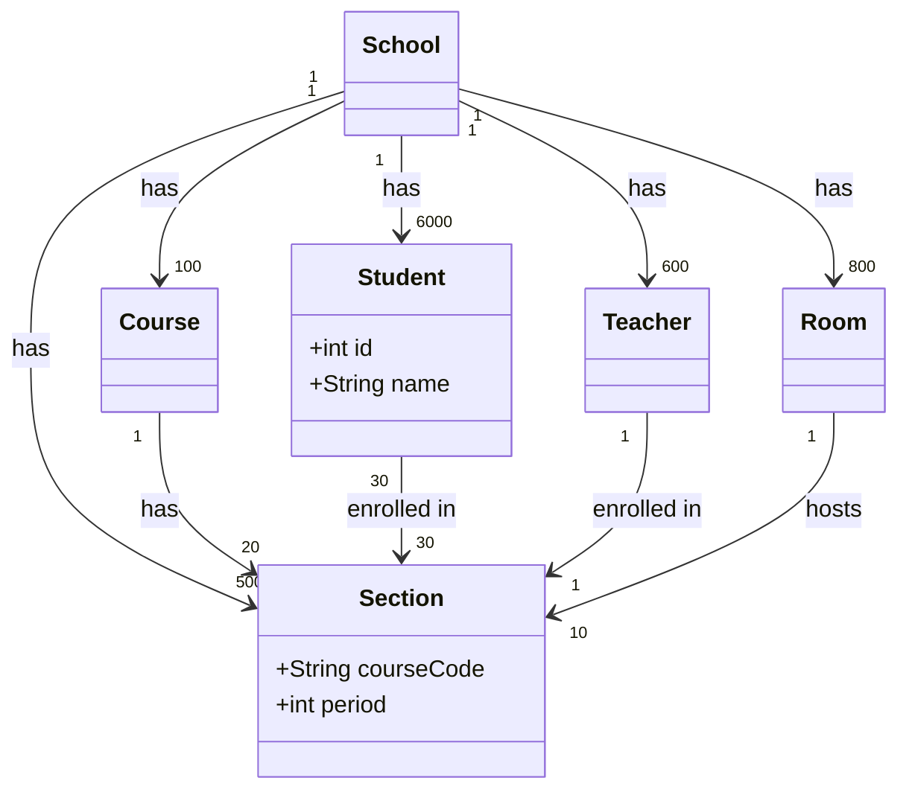

# Let's Design a Software Solution: The Scheduling Problem
by
# GOD BLESS AMERICA
## Lucas Ou (me), Leon Wong
with assistance from
## {list of all collaborators, duckies first)

* * *

#### Step 0: As a trio...  
Review notes from 3rd-yr CS. What data structures and algorithms do you know? What do you recall about class diagrams? Inheritance? Etc...  

#### Step 1: Then proceed...  
> **USAGE:** **[SHAZAAM]** signals Devo input requested. Write response in space provided. _Extra-team "cross-polination" permitted._

---

## BACKGROUND

Stewie Vassant High School (~3,300 students) needs a "software solution" for their management problems. Specifically, with these **resource allotments**:

- **Students** (id, name, grade)
- **Teachers** (id, name, department)
- **Rooms** (room number, capacity, type: lab/gym/classroom)
- **Courses** (code, title, credits)
- **Sections**: one course, taught by one teacher, in one room, during one period; holds up to *capacity* students
- **Enrollments**: which students are in which sections

## CONSTRAINTS

1. No teacher in 2 sections same period
2. No room hosting 2 sections same period
3. No student in 2 sections same period
4. Enrollment cannot exceed room capacity
5. Physics labs must use a room of type `lab`
6. CS labs must use a room of type `cslab`
7. No CS lab may be booked through the SU's club reservation system.

## RULES

Use **only** what you know from APCS-AB|NeXTCS: classes, arrays, `ArrayList`, `HashMap` (dictionary), linked lists, stacks, queues, trees, sorting/searching, and execution time classification (Big-O).

**Hnady vars for runtime classifcations (Big-O):**  
S = students, T = teachers, R = rooms, N = sections, E = enrollments.

---

## Part 1: Design Your Data Structures

### 1.1 Class cards

UML refresher: think of each class as a Monopoly property card:

- **Top:** class name
- **Upper section:** instance variables (`- name : Type`)
- **Lower section:** methods (`+ name(params) : ReturnType`)

Example (partially complete):

```
+----------------------------------+
| Student                          |
+----------------------------------+
| - id : int                       |
| - name : String                  |
| - grade : int                    |
| - ???                            |
+----------------------------------+
| + getName() : String             |
| + ???                            |
+----------------------------------+
```

**[SHAZAAM]** Finish the Student card above (replace every `???`, add as many lines as you need). Then complete a card for each class below. Add your own cards for any extra classes you need.

**Card: Student** (finish the example above; copy your final version here)

```
+----------------------------------+
| Student                          |
+----------------------------------+
| - id : int                       |
| - name : String                  |
| - grade : int                    |
| - schedule : Section[]           |
|                                  |
|                                  |
+----------------------------------+
| - getId() : int                  |
| - getName() : String             |
| - getGrade() : int               |
| - setId() : void                 |
| - setName() : void               |
| - setGrade() : void              |
| - getSchedule() : Section[]      |
| - getSection(int period) : Section|
| - setSection(int period) : void  |
+----------------------------------+
```

**Card: Teacher**

```
+----------------------------------+
| Teacher                          |
+----------------------------------+
| - id : int                       |
| - name : String                  |
| - department : enum Dept         |
| - schedule : Map<period, section>|
| -                                |
+----------------------------------+
| - getId() : int                  |
| - getName() : String             |
| - getDepartment() : enum Dept    |
| - getSchedule() : Section[]      |
| - getSection(int period) : Section|
| - setSection(int period) : void  |
|                                  |
+----------------------------------+
```

**Card: Room**

```
+----------------------------------+
| Room                             |
+----------------------------------+
| - roomNumber : int               |
| - capacity : int                 |
| - type : enum RoomType           |
| - schedule : Map<period, section>|
|                                  |
+----------------------------------+
| - getRoomNumber() : int          |
| - getCapacity() : int            |
| - getType() : enum RoomType      |
| - getSchedule() : Section[]      |
| - getSection(int period) : Section|
| - setSection(int period) : void  |
+----------------------------------+
```

**Card: Course**

```
+----------------------------------+
| Course                           |
+----------------------------------+
| - code : int                     |
| - title : String                 |
| - credits : int                  |
| - sections : Set<Section>        |
| - department : enum Dept         |
|                                  |
+----------------------------------+
| - getCode() : int                |
| - getTitle() : String            |
| - getCredits() : int             |
| - getDepartment() : enum Dept    |
| - getSections() : Set<Section>   |
| - addSection(Section s) : Section|
| - removeSection(Section s) : void|
+----------------------------------+
```

**Card: Section**

```
+----------------------------------+
| Section                          |
+----------------------------------+
| - id : int                       |
| - course : Course                |
| - teacher : Teacher              |
| - students : Set<Student>        |
| - room : Room                    |
| - period : int                   |
+----------------------------------+
| - getId() : int                  |
| - getCourse() : Course           |
| - getTeacher() : Teacher         |
| - getStudents() : Set<Student>   |
| - getRoom() : Room               |
| - getPeriod() : int              |
| - setId() : void                 |
| - setCourse() : void             |
| - setTeacher() : void            |
| - setStudents() : void           |
| - setRoom() : void               |
| - setPeriod() : void             |
+----------------------------------+
```

**Card: Enrollment** (write "NOT NEEDED" in the name box if your design has no such class)

```
+----------------------------------+
| NOT NEEDED                       |
+----------------------------------+
|                                  |
|                                  |
|                                  |
+----------------------------------+
|                                  |
|                                  |
|                                  |
+----------------------------------+
```

**Card: Other (e.g., a Registrar/School class that holds everything)**

```
+----------------------------------+
| School                           |
+----------------------------------+
| - name : String                  |
| - id : int                       |
| - students : HashSet<Student>    |
| - teachers : HashSet<Teacher>    |
| - rooms : HashSet<Room>          |
| - courses : HashSet<Course>      |
| - sections : HashSet<Section>    |
| -                                |
| -                                |
| -                                |
+----------------------------------+
| - getName() : String             |
| - getId() : int                  |
| - getStudents() : HashSet<Student>|
| - getTeachers() : HashSet<Teacher>|
| - getRooms() : HashSet<Room>     |
| - getCourses() : HashSet<Course> |
| - getSections() : HashSet<Section>|
| - addStudent(name, id, grade) : void|
| - addTeacher(name, id, dept) : void|
| - addRoom(number, type, capacity) : void|
| - addCourse() : void             |
| - addSection() : void            |
| - removeStudent() : void         |
| - removeTeacher() : void         |
| - removeRoom() : void            |
| - removeCourse() : void          |
| - removeSection() : void         |
| - enrollStudentToSection() : void|
| - assignTeacherToSection() : void|
| - moveSectionToRoom() : void     |
+----------------------------------+
```

> PROTIP: instance variables may be primitives, Strings, or references to other objects or collections (e.g., `- sections : ArrayList<Section>`).

### 1.2 Where do relationships live?

**[SHAZAAM]** Fill in the two blank columns.

| Relationship | Where is it stored? (which class/object) | Data structure used |
|---|---|---|
| Teacher -> their sections | `Teacher` object (and then each `Section` object has a pointer to one `Teacher` object) | `HashMap<Period, Section>` |
| Room -> its sections | `Room` object (and then each `Section` object has a pointer to one `Room` object) |  `HashMap<Period, Section>` |
| Student -> their sections | `Student` object (and then each `Section` object has a set of `Student`s, see below) |  `HashMap<Period, Section>` |
| Section -> its students | `Section` object (and then each `Student` object has a map of `Sections`s, see above) | `Set<Student>` |

### 1.3 Diagram

**[SHAZAAM]** Replace every `?` with a multiplicity (e.g., `1`, `0..*`). Add every class, field, and link from your design. (mermaid.js|KtS)



---

## Part 2: "Stress-Test" Your Design

For each task, write pseudocode that works on **your** Part 1 design, classify its execution time using Big-O notation.

### 2.1 List all students in section `SPS21H-03`

**[SHAZAAM]** Pseudocode

```
getStudents() // returns a Set of students
```

**[SHAZAAM]** Big-O: `O(1)`

---

### 2.2 Print one student's full schedule

**[SHAZAAM]** Pseudocode

```
getSchedule() // returns a HashMap of sections
```

**[SHAZAAM]** Big-O: `O(1)`

---

### 2.3 List every teacher who teaches a section in Room 251

**[SHAZAAM]** Pseudocode

```
make a Set<Teacher> called teachers
for section in Room.getSections {
    teachers.add(section.getTeacher())
}
return teachers
```

**[SHAZAAM]** Big-O: `O(n)`

---

### 2.4 Enroll a student in a section, enforcing **all five** constraints

**[SHAZAAM]** Pseudocode

```
def enrollStudent(Student, Section) {
    // Student.getSchedule returns a HashMap<Period, Section>
    if (Student.getSchedule[Section.getPeriod()] is not empty) {
        // Can't add to section
    }
    if (Section.getStudents().size() > Section.getCapasity()) {
        // Can't add to section
    }
    Section.addStudent(Student)
    Student.addSection(Section.getPeriod(), Section)
}
```

**[SHAZAAM]** Big-O: `O(1)`

---

### 2.5 Find all students who share at least one class with student 345674267

**[SHAZAAM]** Pseudocode

```
def findAllStudentsWhoShareAtLeastOneClassWith(Student) {
    make a Set<Student> to return
    for Section in Student.getSections() {
        set.join(Section.getStudents())
    }
    return set
}
```

**[SHAZAAM]** Big-O: `O(n)`

---

### 2.6 Find all rooms free during period 4 with capacity >= 32

**[SHAZAAM]** Pseudocode

```
// in the School class
def getFree(int period) {
    make a Set<Room> to return
    for room in Set<Room> {
        if (room.getCapacity() >= 32 and room.getSchedule()[period] is NULL) {
            set.append(room)
        }
    }
    return set
}
```

**[SHAZAAM]** Big-O: `O(          )`

---

### 2.7 List the names of all students taught by Mr. DW

**[SHAZAAM]** Pseudocode

```
def getAllStudents(Teacher) {
    make a Set<Student> to return
    for section in Teacher.getSection() {
        set.join(section.getStudents())
    }
    return set
}
```

**[SHAZAAM]** Big-O: `O(n)`

## Part 3: When Things Go Wrong

Respond as simply as possible to each prompt below.
### 3.1
Ms. Novillo Argudo changes her name. Which objects/structures must you update? Could you miss one?

**[SHAZAAM]** Pseudocode

```
def setName(Teacher t, name n) {
    t.setName(n)
}
```

**[SHAZAAM]** Big-O: `O(1)`


### 3.2
Room 251’s capacity drops from 34 to 24 (fire code). Sections currently have 28 students. How does your design detect this?

**[SHAZAAM]** Pseudocode

```
def setCapacity(Room r, int capacity) {
    r.setCapacity(capacity)
    for (Section s in r.getSections()) {
        if (s.getStudents().size() > r.getCapacity()) {
            s.setStatus(SectionStatus.OVERFLOW)
            // Can probably make an enum SectionStatus that is stored per section object to check if section is valid
        }
    }
}
```

**[SHAZAAM]** Big-O: `O(n)`

### 3.3
A teacher is fired. What happens to their sections? To the students enrolled in them? How do you prevent “dangling references”?

**[SHAZAAM]** Pseudocode

```
def fireTeacher(Teacher t) {
    for (Section s in t.getSchedule()) {
        s.setTeacher(NULL)
        s.setStatus(SectionStatus.NO_TEACHER) // Maybe not needed?
        // Can probably make an enum SectionStatus that is stored per section object to check if section is valid
    }
}
```

**[SHAZAAM]** Big-O: `O(n)`

### 3.4
A DOE spy asks: “Which departments use the most lab-room hours?” How much new code do you write?

**[SHAZAAM]** Pseudocode

```
// In School class
// we have a Dept enum
def getHighestLabHours() {
    create HashMap<Dept, int> called map
    for (Course c in Courses) {
        map[c.getDept]
        for (Section s in c.getSections()) {
            if (s.getRoom().getRoomType() == RoomType.LAB) {
            map[c.getDept] += PERIOD_HR; // some constant storing number of hours in one period
            }
        }
    }

    int highestHours = 0
    Dept highestDept = NULL;
    for (Dept key in map.getKeys()) {
        if (map[key] > highestHours) {
            highestHours = map[key]
            highestDept = key
        }
    }
    return highestDept
}
```

**[SHAZAAM]** Big-O: `O(n^2)`

### 3.5
A DOE bean-counter asks: “Which students are currently enrolled in both "Great Books" and "Systems-Level Programming and Nerd Culture, Part I", and have a GPA of 85 or above?” How much new code do you write?

**[SHAZAAM]** Pseudocode

```
make Set<Student> called studentsEnrolledInGreatBooksAndSystemsLevelProgrammingAndNerdCultureAndHaveHighGPAAboveEightyFive
for (Student s in Students) {
    if (GreatBooks in s.getSchedule().getValues() && Systems in s.getSchedule().getValues() && s.getGPA() >= 85) {
        studentsEnrolledInGreatBooksAndSystemsLevelProgrammingAndNerdCultureAndHaveHighGPAAboveEightyFive.add(s)
    }
}
```

**[SHAZAAM]** Big-O: `O(n)`

### 3.6
Two counselors each enroll a student into the last seat in a given section at the same time. What happens?

```
notify guidance counselors, handle error.
```

### 3.7
Your program crashes (or even concludes w/o error). Where is your data?

```
In a very big CSV file or a database
```

### 3.8
??? Conjure at least 1 other pain point you have identified on your own, and explain why it is an issue.

```
Not necessarily bad, but our School class handles most of the logic and maintaining all the data.


```
---


---

